# OSS Week 12 — React Hooks Playground (22200619-임성열)

## Project Information
## 프로젝트 소개
- React의 useEffect와 useRef를 활용하여 타이머를 제어하고 입력창 포커스 기능을 구현하는 실습 프로젝트
## Starter Project 정보
- sample로 제공된 React와 Vite 기반의 week12_starter_project
- 각 Lab의 TODO를 완성하고 프로젝트 제목, 설명, 배경 및 버튼 색상을 변경하였다.

## Installation
### 설치·실행 방법
- npm install
- npm run dev
### 실행 화면
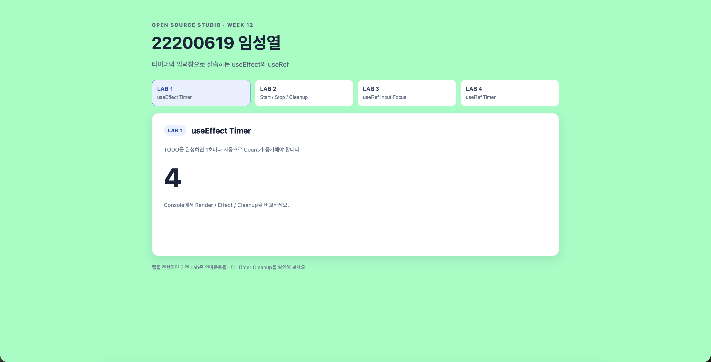

## Source Code Exploration
### 주요 파일 구조

```text
week12_starter_project/
capture/ 
src/
│   ├── components/
│   │   ├── Lab1_EffectTimer.jsx 
│   │   ├── Lab2_TimerControl.jsx
│   │   ├── Lab3_InputFocus.jsx
│   │   └── Lab4_RefTimer.jsx
│   ├── App.jsx 
│   ├── App.css   
│   └── main.jsx     
└── index.html
```

- App.jsx는 선택된 탭을 useState로 관리하고 해당 Lab 컴포넌트를 표시한다. 
- 다른 탭을 선택하면 기존 Lab이 언마운트되고 새로운 Lab이 마운트된다. 
- main.jsx는 React 앱을 DOM에 연결하며, StrictMode를 적용하여 개발 환경에서 컴포넌트와 Effect의 동작을 점검한다.

### useEffect 및 useRef 분석
#### useEffect
- useEffect는 타이머처럼 컴포넌트 외부에서 진행되는 작업을 생성하고 정리하는 데 사용됨. 
- LAB 1은 빈 의존성 배열을 사용하여 마운트 시 타이머를 생성하고, 언마운트 시 Cleanup에서 해제. 
- LAB 2는 running을 의존성 배열에 넣어 실행 상태가 변경될 때 타이머를 생성하거나 정리. 
- LAB 4에서는 버튼 함수가 타이머를 직접 제어하므로, useEffect는 언마운트 시 남아 있는 타이머를 정리하는 역할.

#### useRef
- useRef는 렌더링 사이에 유지해야 하는 값을 저장하거나 실제 DOM 요소를 참조. 
- LAB 3의 inputRef는 입력창 DOM을 참조하여 포커스 이동과 입력값 초기화. 
- LAB 4의 timerRef는 타이머 ID를 저장하여 start와 stop 함수가 같은 타이머에 접근. 
- ref의 값을 변경해도 재렌더링이 발생하지 않으므로, 화면에 표시하는 count와 running은 useState로 관리

### 주요 코드 2개 설명

#### 1. LAB 2의 상태 기반 타이머 제어

파일: src/components/Lab2_TimerControl.jsx

```jsx
useEffect(() => {
  if (!running) {
    return;
  }

  const timerId = setInterval(() => {
    setCount(prev => prev + 1);
  }, 1000);

  return () => {
    clearInterval(timerId);
  };
}, [running]);
```

- running이 true이면 타이머를 생성하여 1초마다 count를 증가시키고, false이면 새로운 타이머를 생성하지 않음. 
- 함수형 상태 업데이트를 사용하여 최신 이전 상태를 기준으로 값을 증가시킴. 
- running이 변경되면 이전 Effect의 Cleanup이 먼저 실행되어 기존 타이머를 해제하며, 컴포넌트가 언마운트될 때도 동일하게 정리.
- 이를 통해 상태 변화에 맞춰 타이머를 제어하고 중복 실행을 방지한다.

#### 2. LAB 4의 ref 기반 타이머 제어

파일: src/components/Lab4_RefTimer.jsx

```jsx
const timerRef = useRef(null);

const start = () => {
  if (timerRef.current !== null) return;

  timerRef.current = setInterval(() => {
    setCount(prev => prev + 1);
  }, 1000);

  setRunning(true);
};

const stop = () => {
  clearInterval(timerRef.current);
  timerRef.current = null;
  setRunning(false);
};
```

- start 함수는 timerRef.current에 타이머 ID가 있는지 확인하여 중복 생성을 방지하고, 새로운 타이머를 생성하면 반환된 ID를 ref에 저장. 
- stop 함수는 저장된 ID로 타이머를 해제하고 ref를 null로 초기화하여 다시 시작할 수 있도록 구성. 
- 타이머 ID는 재렌더링 이후에도 유지되며, running 상태는 실행 상태 문구와 버튼 활성화를 갱신하는 데 사용된다. 
- LAB 2와 달리 이벤트 핸들러가 타이머의 생성과 정지를 직접 처리한다.

## Lab Implementation
### LAB 1: useEffect Timer
- useState로 카운트 값을 관리하고, useEffect 내부에서 setInterval()을 사용하여 1초마다 카운트가 증가하도록 구현하였다. 
- 함수형 업데이트인 setCount(prev => prev + 1)을 사용하여 이전 상태를 기준으로 값을 증가시키고, Cleanup에서 clearInterval()을 호출하여 타이머를 정리하도록 하였다. 
- 정상 실행 시 화면에 표시된 카운트가 0부터 1초마다 증가하며, 다른 LAB으로 이동하면 타이머가 정리된다.

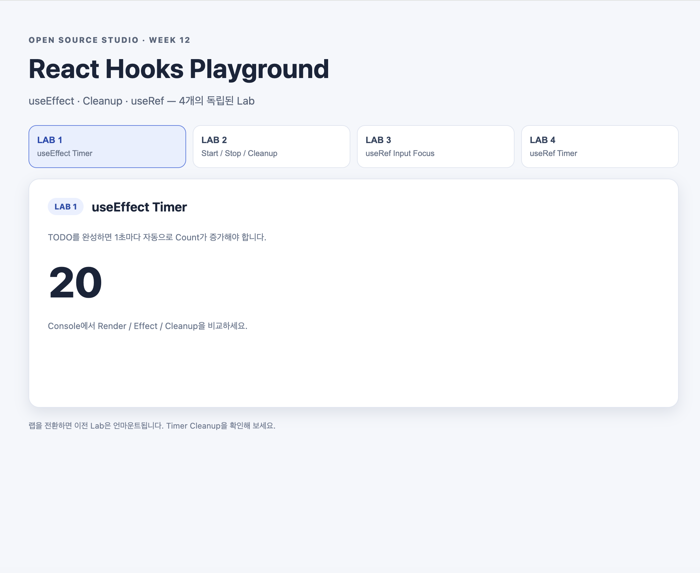

### LAB 2: Timer Start / Stop / Reset
- running 상태와 이를 의존성으로 갖는 useEffect를 이용하여 타이머의 실행과 정지를 제어하도록 구현하였다. 
- Start 버튼은 running을 true로 변경하여 타이머를 시작하고, Stop 버튼은 false로 변경하여 Cleanup을 통해 타이머를 정지한다. 
- Reset 버튼은 타이머를 정지하고 카운트를 0으로 초기화한다. 정상 실행 시 Start를 누르면 카운트가 증가하고, Stop을 누르면 현재 값에서 멈추며, 다시 Start를 누르면 이어서 증가한다. 
- 실행 중에는 Start 버튼이 비활성화되어 중복 실행을 방지한다.
#### 초기 사진
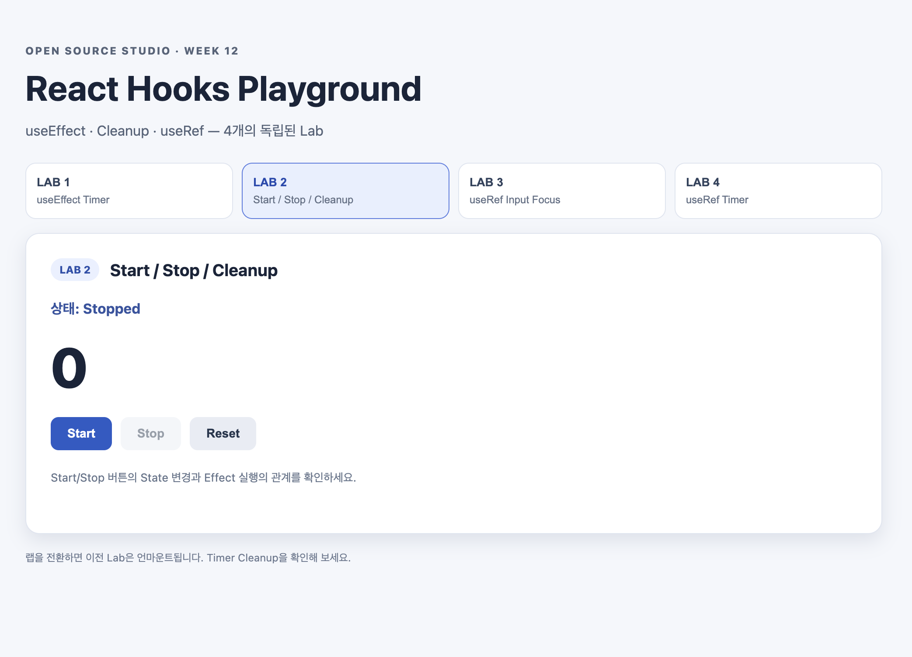
#### Running 사진
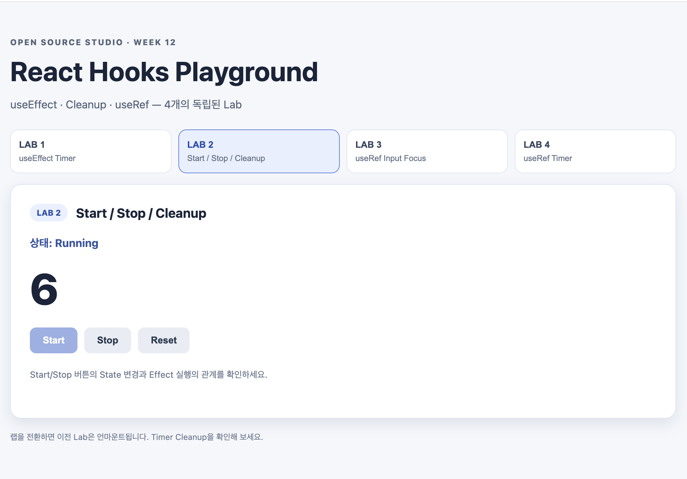
#### Stopped 사진
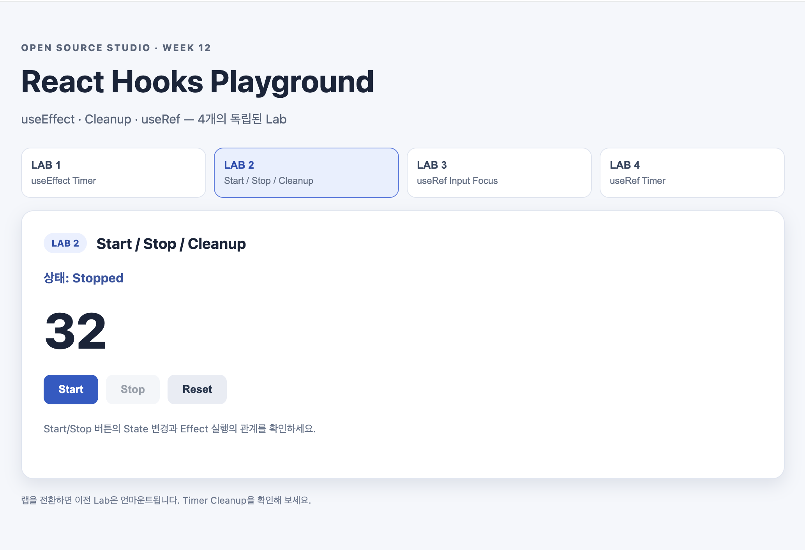
#### Reset 사진
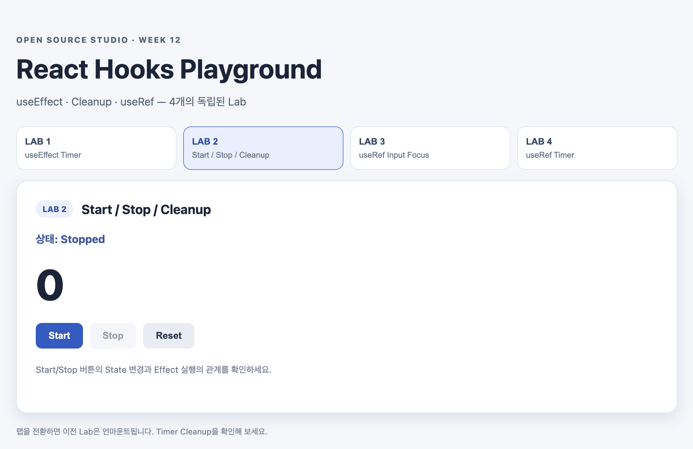


### LAB 3: Input Focus with useRef
- useRef로 생성한 inputRef를 입력창에 연결하여 실제 DOM 요소를 제어하도록 구현하였다. 
- Focus 버튼은 inputRef.current.focus()를 호출하여 입력창으로 포커스를 이동하고, Clear 버튼은 입력값을 빈 문자열로 변경한 뒤 다시 포커스를 설정한다. 
- 정상 실행 시 Focus 버튼을 누르면 바로 입력할 수 있으며, Clear 버튼을 누르면 기존 내용이 지워지고 입력창을 다시 클릭하지 않아도 새로운 내용을 입력할 수 있다.

#### focus/clear 버튼 사진
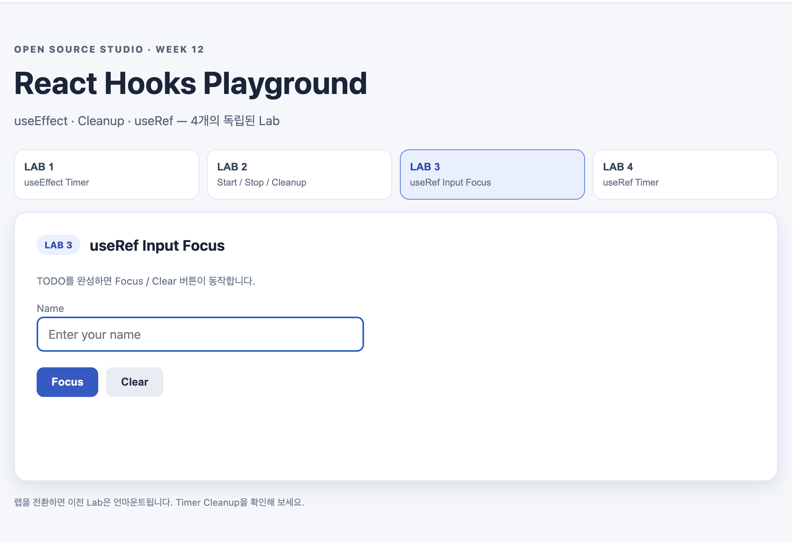


### LAB 4: Timer with useRef
- useRef에 타이머 ID를 저장하고, start()와 stop() 이벤트 핸들러에서 타이머를 직접 제어하도록 구현하였다. 
- Start 실행 시 이미 저장된 타이머 ID가 있으면 새로운 타이머 생성을 막고, Stop 실행 시 타이머를 해제한 뒤 ref를 null로 초기화한다. 
- Reset은 타이머 정지 후 카운트를 0으로 변경하며, 언마운트 시에는 Effect의 Cleanup으로 타이머를 정리한다. 
- 정상 실행 시 시작·정지·재시작·초기화가 가능하며, 타이머 ID는 ref로 유지하고 화면에 표시되는 카운트와 실행 상태는 state로 관리한다.

#### 초기 사진
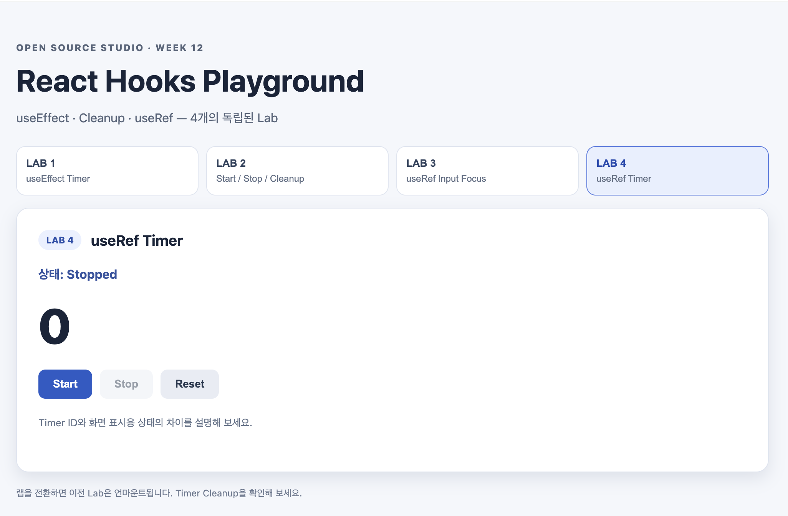
#### Running 사진
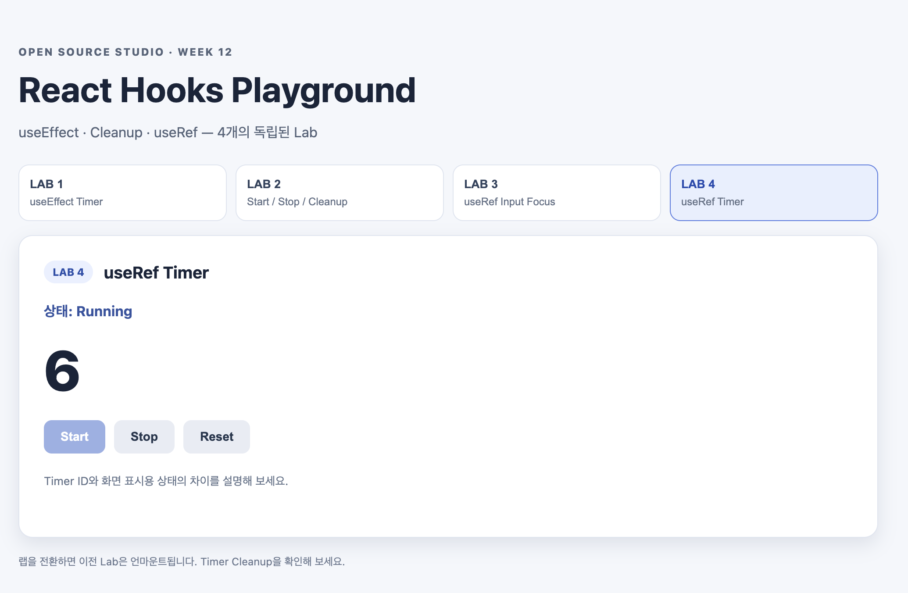
#### Stopped 사진
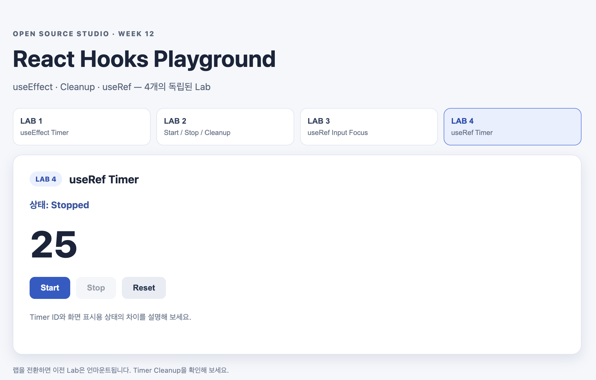
#### Reset 사진
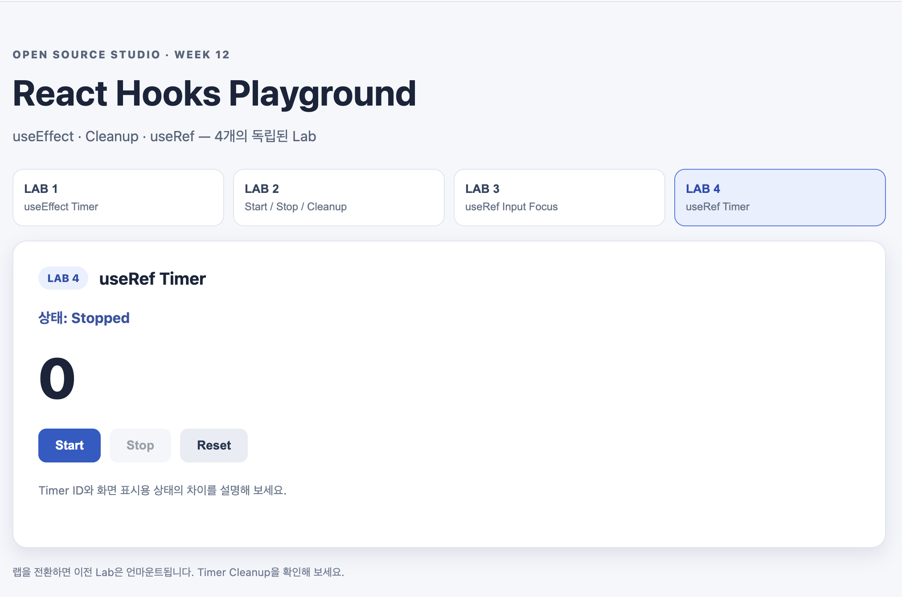


## Lab Comparison

1. **useEffect의 Dependency Array가 필요한 이유는?**  
- Dependency Array는 Effect가 값의 변화에 따라 다시 실행될지 정하기 위해서 필요하다. 
- 배열을 생략하면 컴포넌트가 커밋될 때 실행되고, 빈 배열 []을 전달하면 최초 마운트 시 실행되며, [count]처럼 값을 넣으면 최초 마운트 및 count 변경이 일어날 때 실행된다. 
- 이를 통해 불필요한 실행을 줄이고 상태 변화에 맞춰 외부 작업을 관리할 수 있다.

2. **Cleanup을 사용하지 않으면 어떤 문제가 발생할 수 있는가?**  
- Cleanup을 사용하지 않으면 기존 타이머나 이벤트 리스너가 제거되지 않아 일어나지 않아도 되는 작업이 계속 실행될 수 있다. 
- 타이머의 경우 Effect가 다시 실행될 때 중복 생성되어 카운트가 예상보다 빠르게 증가하거나, 컴포넌트가 사라진 이후에도 실행될 수 있다. 
- 따라서 Effect가 다시 실행되기 전과 컴포넌트가 언마운트될 때 Cleanup에서 clearInterval() 등을 호출하여 기존 작업을 정리해야 한다.

3. **useState와 useRef의 가장 중요한 차이는?**  
- 가장 중요한 차이는 값의 변경이 다시 렌더링을 유발하는지 여부이다. 
- useState는 setter를 통해 다른 값으로 변경하면 다시 렌더링을 요청하므로 count, running처럼 화면에 반영할 값을 관리하는 데 사용한다. 
- 반면 useRef는 .current를 변경해도 재렌더링을 유발하지 않는다.

4. **LAB 2와 LAB 4의 Timer 관리 방식은 어떻게 다른가?**  
- LAB 2는 running 상태 변화에 따라 Effect가 타이머를 생성하고 Cleanup이 타이머를 정리하며, 타이머 ID를 Effect 내부의 지역 변수에 저장한다. 
- 반면 LAB 4는 start()와 stop() 이벤트 핸들러에서 타이머를 직접 생성하거나 해제하고, 타이머 ID를 useRef에 저장한다. 
- LAB 4의 running은 화면 상태와 버튼 활성화를 관리하며, Effect는 컴포넌트가 언마운트될 때 타이머를 정리하는 역할을 한다. 

## Customizing

### 1. 프로젝트 제목 및 설명 변경
- 수정 파일: `src/App.jsx`
- 프로젝트 제목을 “React Hooks Playground”에서 “22200619 임성열”로 변경. 
- 설명은 “타이머와 입력창으로 실습하는 useEffect와 useRef”로 수정하여 프로젝트에서 다루는 주요 기능을 표시.

### 2. 전체 배경색 변경
- 수정 파일: src/App.css
- body의 배경색을 기존 #f5f7fb에서 밝은 초록색인 #8bffbf 로 변경.

### 3. 기본 버튼 배경색 변경
- 수정 파일: src/App.css
- .controls button의 배경색을 기존 파란색인 #285bc7에서 초록색인 #28c76a로 변경하여 전체 배경과 색상 계열을 맞췄다. 
- Start와 Focus 버튼에 적용되며, 글자색은 흰색으로 유지하였다. Stop, Reset, Clear 버튼은 기존의 보조 버튼 스타일을 유지하여 주요 버튼과 구분.


## Deployment: 실제 접근 가능한 Vercel URL
- https://week12-starter-project-dusky.vercel.app/


## Weekly Review
### 새롭게 배운 내용 3가지

1. useEffect의 의존성 배열에 따라 Effect의 실행 시점이 달라진다는 것을 배웠다. 빈 배열을 사용하면 마운트 시 실행되고, 특정 상태를 넣으면 해당 상태가 변경될 때 다시 실행된다. LAB 2에서는 running을 의존성 배열에 넣어 타이머의 실행 상태를 조정하였다.

2. Cleanup은 Effect가 다시 실행되기 전이나 컴포넌트가 언마운트될 때 기존 작업을 정리하는 역할을 한다는 것을 배웠다. 타이머를 생성한 뒤 clearInterval로 정리하지 않으면 중복 실행되거나 화면을 이동한 후에도 계속 동작할 수 있어 Cleanup이 필요하다.

3. useState와 useRef는 모두 렌더링 사이에 값을 유지하지만, 값 변경 시 재렌더링을 유발하는지에 차이가 있다는 것을 배웠다. 화면에 표시하는 count와 running은 state로 관리하고, 입력창 DOM이나 타이머 ID는 ref로 관리하면서 각각의 사용 목적을 이해하였다.

### 어려웠던 점과 해결 방법

- LAB 4에서 useRef를 활용하여 타이머를 구성하는 과정이 어려웠다. 특히 LAB 2처럼 running 상태로 타이머를 제어하는 방식과 달리, start와 stop 함수에서 직접 타이머를 생성하고 정리하는 흐름이 헷갈렸다. 이를 해결하기 위해 타이머 ID를 저장하는 timerRef와 화면 상태를 관리하는 running의 역할을 구분하고, 시작·정지·초기화·Cleanup 순서로 기능을 나누어 구현하였다. 또한 정지할 때 clearInterval만 호출하는 것이 아니라 ref를 null로 초기화해야 다시 시작할 수 있다는 점을 이해하면서 전체 동작 흐름을 정리하였다.

### AI 활용 내용 및 느낀 점
- AI를 활용하여 useEffect와 useRef의 개념과 사용 목적을 알아보고, 각 Lab에서 어떤 역할을 하는지 이해하였다. 특히 useEffect가 Dependency Array에 따라 실행되는 방법이 달라지고 Cleanup으로 기존 작업을 정리한다는 점과, useRef는 재렌더링 없이 값을 유지하거나 DOM을 참조하는 데 사용된다는 점에 대한 개념을 알아 볼 수 있는 부분이 좋았다. 